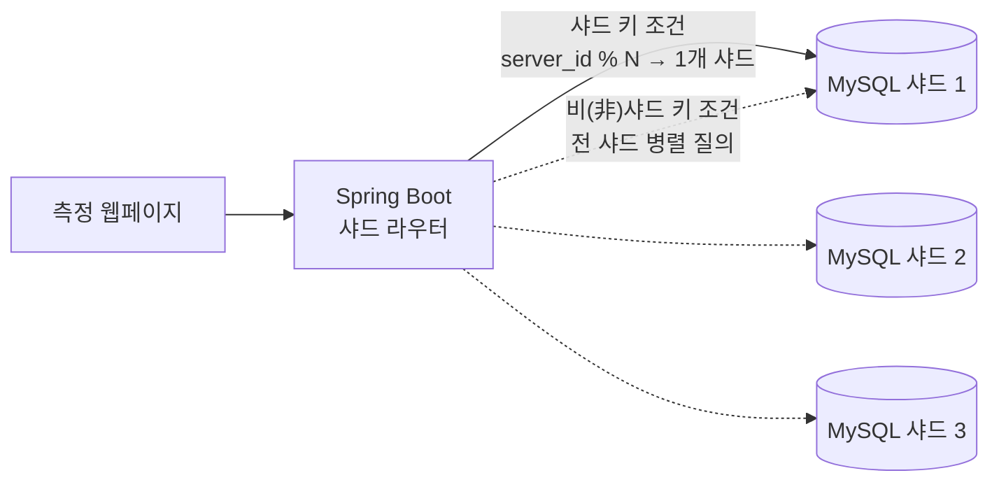

# MySQL 모듈러 샤딩 조회 성능 연구

로그 960만 건을 MySQL 샤드 1·2·3개로 수평 분할(Horizontal Partitioning)하고, 쿼리 실행 방식별로 샤딩 효과를 측정한 프로젝트.

- 기간 — 2024.03.25 ~ 2024.06.10 · 4인 팀 프로젝트
- 협업 — VDI 기업 틸론(Tilon)의 서버·로그 구조를 모델링, 화상 회의 진행
- 기술 — Java 17 · Spring Boot 3.2.5 · Spring JDBC · MySQL 8.0.29 · Thymeleaf · JMeter

 

## 한눈에 보기

| 항목 | 내용 |
|---|---|
| 질문 | 샤드를 늘리면 모든 조회가 빨라지는가 |
| 구성 | 애플리케이션 레벨 샤딩 — 샤드 키 `server_id`에 모듈로 연산(`% N`) 적용, 물리 서버별 MySQL 인스턴스를 샤드로 사용 |
| 결론 | 샤딩 효과는 실행 계획에 따라 1.4~3.6배로 차이 — 샤드 키 조회·풀 테이블 스캔에서 크고, PK 범위 스캔에서 작음 |
| 시사점 | 샤딩 전에 쿼리 설계가 우선 — 샤딩 없이 조회 컬럼 축소(`SELECT *` → `SELECT log_id`)만으로 2.6~5.5배 개선 |

 

## 시스템 구성

- `users` — VDI 사용자 · `servers` — 사용자별 VDI 서버 · `logs` — 서버 로그 (960만 건)
- `servers`·`logs`를 같은 샤드 키(`server_id`)로 분배 → 연관 데이터가 같은 샤드에 위치(Co-location)
- 코드상 `server_id` 컬럼명은 `linker_id`

 

## 쿼리 라우팅

- 샤드 키 조건 — 모듈로 연산으로 대상 샤드 1곳을 계산해 단일 샤드만 조회(Single-shard Routing)
- 비샤드 키 조건 — 전 샤드에 `CompletableFuture`로 동시 질의 후 전체 완료 대기(Scatter-Gather)
- 측정 전용 API — 조회 결과 대신 응답 시간(ms)을 반환

 

## 설계 결정과 트레이드오프

### 1. 샤딩 위치 — 애플리케이션 레벨

- 구현 — 샤드별 `DataSource`·`JdbcTemplate`를 두고 애플리케이션에서 직접 라우팅
- 장점 — 라우팅·병렬 질의 동작을 코드 수준에서 통제하고 측정 가능
- 대가 — 샤드 구성이 코드에 고정 → 샤드 추가 시 코드 수정 필요 · 운영 환경에서는 라우팅 계층 분리 또는 샤딩 미들웨어 필요

### 2. 분배 방식 — 모듈로 샤딩

- 장점 — 계산 단순 · 키가 고르게 분포 → 샤드별 데이터량 균등 (960만 → 480만 × 2 / 320만 × 3)
- 대가 — 샤드 수 변경 시 대부분의 키가 다른 샤드로 이동 → 리샤딩(Resharding) 비용 큼 · 일관 해싱(Consistent Hashing) 대비 확장성 약점

### 3. 비샤드 키 조회 — Scatter-Gather

- 장점 — 샤드당 처리량이 1/N로 감소 → 풀 테이블 스캔 시간 단축
- 대가 — 응답 시간이 가장 느린 샤드에 좌우 · 결과 병합·정렬·페이징을 애플리케이션이 담당 (본 실험은 측정 목적으로 병합 생략)

 

## 측정 결과

| 쿼리 | 실행 방식 | 샤드 1 | 샤드 2 | 샤드 3 | 1→3 개선 |
|---|---|---:|---:|---:|---:|
| `server_id =` · `SELECT log_id` | 샤드 키 조회 | 3,235 | 1,404 | 910 | **3.6배** |
| `server_id =` · `SELECT *` | 샤드 키 조회 | 4,610 | 2,156 | 1,434 | **3.2배** |
| 사용자의 전체 서버 로그 · `SELECT *` | 조인 (샤드 내 로컬 조인) | 12,445 | 6,326 | 4,588 | 2.7배 |
| `created_at` 1분 범위 (1.4만 건) · `SELECT log_id` | 풀 테이블 스캔 | 10,310 | 5,731 | 3,962 | 2.6배 |
| `created_at` 1시간 범위 (91.7만 건) · `SELECT *` | 풀 테이블 스캔 | 16,931 | 10,810 | 8,237 | 2.1배 |
| `log_id` 96만 건 범위 · `SELECT log_id` | PK 범위 스캔 (컬럼 1개) | 2,627 | 1,931 | 1,574 | 1.7배 |
| `log_id` 96만 건 범위 · `SELECT *` | PK 범위 스캔 (전체 컬럼) | 6,908 | 5,047 | 4,885 | 1.4배 |

단위 ms · 측정 도구 JMeter

### 핵심 관찰

- 샤드 키 조회 효과 최대 (3.2~3.6배) — 대상 샤드 1곳만 조회하고, 해당 샤드의 데이터량이 1/3로 감소
- 풀 테이블 스캔은 결과 건수와 무관하게 비용이 테이블 크기에 비례
  - `SELECT log_id` 기준 1분(1.4만 건) 조회와 1시간(91.7만 건) 조회가 모두 약 10초 소요
  - 샤드 수만큼 테이블이 작아져 2.1~2.6배 개선
- 결과 행 수가 비슷하면(약 92만~96만 건) 풀 테이블 스캔(2.1배)이 PK 범위 스캔(1.4배)보다 샤딩 효과가 큼
  - 범위 스캔은 비용이 결과 행 수에 비례하고, 전체 결과 행 수는 샤드를 나눠도 그대로임
- 조회 컬럼 축소 효과가 샤딩보다 큼 — 샤딩 없이 `SELECT *` → `SELECT log_id`만으로 96만 건 범위 2.6배, 960만 건 전체 범위 약 5.5배
- 샤드 키 기준 Co-location 덕분에 조인도 샤드 내에서 처리 → 2.3~2.7배

### 측정 차트

추가 차트 — 조회 컬럼 비교 · PK 범위 스캔 vs 풀 테이블 스캔

 

## 측정 환경

- 데이터 — 로그 960만 건 · 샤드 1개(960만) / 2개(480만 × 2) / 3개(320만 × 3)
- 서버 — Intel Xeon Gold 6134 (8코어 16스레드, 3.2GHz) · RAM 8GB · Windows 11
- 네트워크 — 다운로드 477.76Mb/s · 업로드 486.43Mb/s

 

## 한계와 개선 방향

- 측정 범위가 조회(SELECT)에 한정 — 쓰기 부하·샤드 간 트랜잭션 비용 미측정
- 리샤딩 미검증 — 샤드 수 변경 시 데이터 재배치 절차·소요 시간 미측정
- 샤드 키가 다른 조건의 조인 — 샤드 간 조인(Cross-shard Join)이 필요해 본 구조로는 미지원

 

## 팀

- 조민서(팀장) — 조회 API·측정 웹페이지 구현
- 지수영 · 박태성 · 황성헌
